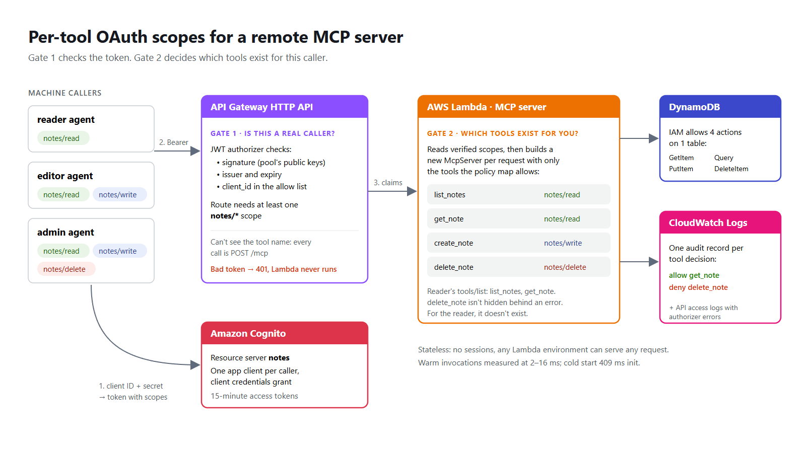

# Per-tool OAuth scopes for a remote MCP server on AWS

A remote [Model Context Protocol](https://modelcontextprotocol.io) server on AWS Lambda where **each caller only sees the tools its OAuth scopes allow**.

An OAuth authorizer in front of `/mcp` answers "is this a real caller?". It can't answer "may this caller use `delete_note`?", because every MCP call is `POST /mcp` and the tool name is inside the JSON-RPC body. This project adds that second gate.



| Caller | Token scopes | `tools/list` returns |
|---|---|---|
| `reader` | `notes/read` | `list_notes`, `get_note` |
| `editor` | `notes/read notes/write` | `list_notes`, `get_note`, `create_note` |
| `admin` | `notes/read notes/write notes/delete` | all four |

## How it works

1. **Amazon Cognito** issues client-credentials access tokens. A resource server `notes` defines three scopes, and each caller's app client may only request its own subset.
2. **API Gateway HTTP API** validates the JWT (signature, issuer, expiry, client ID) and requires at least one `notes/*` scope. Bad tokens never reach Lambda.
3. **AWS Lambda** reads the verified scopes and builds a fresh `McpServer` per request, registering only the tools the scopes allow ([`src/policy.ts`](src/policy.ts), [`src/server.ts`](src/server.ts)). Hidden tools are absent from `tools/list`, and calling one fails as "tool not found".
4. **Least privilege underneath:** the function role has no AWS managed policies, only its own log group and four DynamoDB actions on one table. cdk-nag's AWS Solutions checks run on every synth.
5. **Audit:** every allow and deny is logged as a structured record you can query in CloudWatch Logs Insights.

The server is stateless (no `Mcp-Session-Id`), uses the official MCP TypeScript SDK's web-standard Streamable HTTP transport, and returns plain JSON responses.

## Project layout

```
src/
  policy.ts      tool -> scope map (single source of truth)
  principal.ts   reads the caller from the API Gateway JWT authorizer context, fails closed
  server.ts      builds the per-request McpServer with only the allowed tools
  app.ts         Lambda handler: API Gateway v2 event <-> web Request/Response
  store.ts       DynamoDB store (+ in-memory store for tests)
  audit.ts       structured audit records
  handler.ts     Lambda entry point
infra/           CDK app and stack (Cognito, API Gateway, Lambda, DynamoDB, logs)
test/            unit tests + a test that drives the handler with the official MCP client
scripts/         token helper and end-to-end demo against the deployed stack
```

## Prerequisites

- Node.js 22 or later
- AWS CLI v2 with credentials for the target account
- The account and Region bootstrapped for CDK: `npx cdk bootstrap`

## Run the tests

```bash
npm install
npm test
```

19 tests cover scope filtering, denied calls, malformed input, ID tokens, missing authorizer context, `GET` → 405, and a full round trip with the official MCP TypeScript client.

## Deploy

```bash
npm run deploy          # cdk deploy, writes cdk-outputs.json
npm run demo            # three callers, three tool lists, one prompt-injection attempt
```

The Cognito domain prefix defaults to `notes-mcp-<account-id>`. Override it with `npx cdk deploy -c domainPrefix=my-prefix` if needed.

### Connect from Claude Code

```bash
TOKEN=$(npm run -s token -- reader)
claude mcp add --transport http notes-reader "<McpUrl from cdk-outputs.json>" \
  --header "Authorization: Bearer $TOKEN"
```

Tokens last 15 minutes.

### Query the audit log

In CloudWatch Logs Insights, on the function's log group (`FunctionLogGroup` output):

```
filter message.type = "mcp.audit"
| stats count(*) as calls by message.tool as tool, message.decision as decision, message.reason as reason
| sort tool, decision
```

## Clean up

```bash
npm run destroy
```

## Cost

Lambda, API Gateway HTTP API, DynamoDB on demand and CloudWatch Logs cost close to nothing at demo volume. Cognito bills machine-to-machine token requests with no free tier for that use, so long-running callers should cache tokens. Check current pricing for your Region.

## Limits

- Machine-to-machine only. Interactive sign-in from MCP clients needs an authorization server that supports the client registration methods those clients expect; Cognito user pools only support pre-registered app clients.
- Authorization is per tool, not per record. Every caller with `notes/read` can read every note.
- Scopes reduce what a prompt-injected agent can do; they don't prevent prompt injection.

## License

MIT-0. See [LICENSE](LICENSE).
